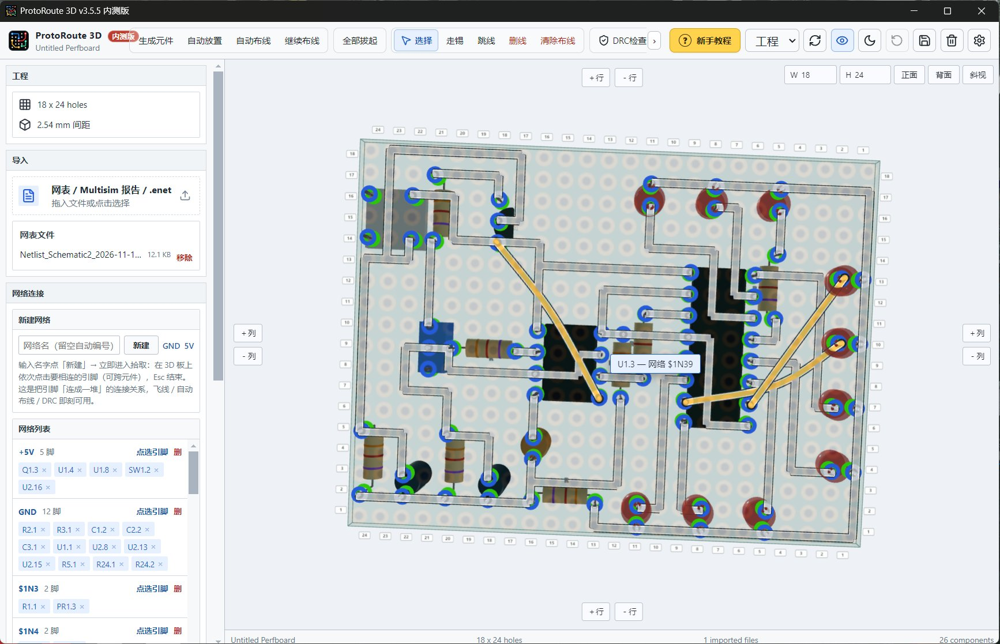
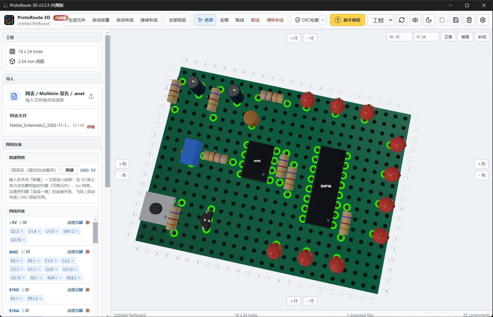

  

<h1 align="center">洞洞板布线 HoleRoute3D</h1>

  <b>在电脑里摆元件、布走线，再照着 3D 图焊接洞洞板</b> 
  中文界面 · 支持嘉立创 EDA 网表 · Windows 解压即用

  
  
  

> **内测提醒：** 软件仍可能有 BUG。自动布线不保证最优，DRC 也可能漏报或误报；焊接前请对照原理图检查，重要工程请导出 JSON 备份。

---

## 1. 改编声明

本项目是 **Tomjiang678** 的 [Perfboard-AutoRoute-3D-Windows](https://github.com/Tomjiang678/Perfboard-AutoRoute-3D-Windows) v2.0.0 的非官方修改版，不是原作者发布的官方版本。

原项目未提供开源许可证；本仓库的 MIT 许可只覆盖新增脚本、测试工具与文档，应用代码权利仍归原作者。商用或二次分发前请先联系原作者，详见 [NOTICE.md](NOTICE.md)。

## 2. 这个软件能做什么

洞洞板又叫万能板、万用板。这个软件可以把原理图导出的**网表**变成一块可旋转的 3D 电路板，帮助你在焊接前完成：

- **摆元件：** 按引脚间距把元件放到孔位上，可旋转、拖动和微调；
- **布线路：** 自动或手动安排板背面的走锡，以及跨越其他线路的跳线；
- **查问题：** 用 DRC 检查未连通、错网短路、孔位冲突等情况；
- **看连接：** 用飞线层查看哪些引脚还没有真正连通；
- **存工程：** 自动保存在本机，也可导出 JSON 备份或换电脑继续编辑。

它适合教学实验、模块板、转接板和中小规模自制电路；**不适合代替专业 PCB 软件设计多层板、高速或大电流电路。**

| 实体视图 | 透视视图 |
|---|---|
|  |  |

## 3. 如何安装

本版是 **Windows 64 位免安装版**，不需要安装 Python、Node.js 或其他运行环境。

1. 打开 **[最新版下载页](https://github.com/november-is-your-birthday/HoleRoute3D/releases/latest)**；
2. 下载名称类似 `ProtoRoute3D-v3.5.5-cn-win-x64.zip` 的压缩包；
3. 把压缩包**完整解压**到一个文件夹，例如 `D:\HoleRoute3D`；
4. 双击文件夹里的 **`ProtoRoute 3D.exe`**。

**注意：**

- 不要只复制 exe。旁边的 `resources`、`locales`、DLL 等文件都必须保留；
- 如果 Windows 弹出“已保护你的电脑”，这是因为程序没有代码签名。确认安装包来自本项目 Release 后，可点“更多信息 → 仍要运行”；
- 窗口标题显示 `ProtoRoute 3D v3.5.5 内测版`，表示当前版本正确；
- 完全退出旧版后再启动新版，避免后台进程仍在运行旧程序。

## 4. 入门使用说明

第一次使用时，可以先点顶部黄色的 **“新手教程”**，或按 **F1**。软件内教程包含图示化的章节导航，即使还没新建工程也能看。

### 4.1 先从原理图导出网表

网表记录了“有哪些元件、每只引脚接到哪里”，软件需要它来知道电路连接关系。

**嘉立创 EDA 专业版（推荐）：**

1. 打开原理图，选择 **文件 → 导出 → 网表**；
2. 优先选择 **嘉立创 EDA（专业版）`.enet`**；
3. 旧流程导出的 **Protel2 / Protel 99SE `.net`** 也可以使用。

`.enet` 能提供更多封装和引脚信息，推荐优先使用。

**其他软件：**

- **KiCad：** 导出 KiCad 格式的 `.net`；
- **嘉立创 EDA 标准版：** 导出 Protel 格式的 `.net`；
- **Multisim：** 从 `Tools → Reports` 分别导出 **Wire List** 和 **Cross Reference**，两份 `.txt` 或 `.csv` 一起导入，缺一不可；
- **不支持 `.cir` SPICE 网表**，因为它通常没有软件需要的元件引脚号。

### 4.2 新建工程

1. 点击 **“新建”**；
2. 填写工程名称；
3. 选择 **洞洞板**或**面包板**；
4. 设置板的宽和高。这里的数字是**孔数**，不是厘米；
5. 点击 **“创建”**。

洞洞板尺寸之后也能在视图左上角的 `W / H` 中修改。输入完成后按回车或点别处生效。

### 4.3 导入网表并生成元件

1. 把网表文件拖到左侧 **“导入”**区域，或点击该区域选择文件；
2. 查看左侧 **“导入结果”**，核对元件数和网络数；
3. 点击顶部 **“生成元件”**，快捷键 **G**。

> **导入成功不等于元件已经出现在板上。** 必须再点一次“生成元件”。

如果出现“库中无对应封装”，软件会暂时用排针代替。选中该元件，在属性面板中核对脚距和排距；模型不准确时，不要盲目照图焊接。

### 4.4 摆放元件

**自动摆放：** 点击 **“自动放置”**（P），设置允许摆放的区域后开始。元件较多时计算较慢，可以看到进度，也可以取消。

**手动添加：** 点击 **“元件库”**，选择元件，再在板上点击放置；右键取消待放置状态。

**调整位置：**

| 操作 | 方法 |
|---|---|
| 移动元件 | 按住 `Shift` 拖动，修饰键可在设置中修改 |
| 旋转元件 | 选中后按 `R`，或使用右键菜单 |
| 多选 | 按住 `Ctrl` 逐个点击 |
| 放置 / 拔起 | `M` / `U` |
| 删除元件 | 选中后按 `Delete` |

**三极管、二极管和 LED 要特别核对方向：**

- 三极管属性面板会显示 NPN / PNP、封装、脚号、孔位和网络；
- 黄色 E/B/C 是软件按封装给出的**暂标**，应再对照具体型号的数据手册；
- 如果脚序不符，在“**三极管脚序**”下拉框中手动选择，确认后字母变白；
- 二极管的黑色环位于负极一侧；LED 的黑色竖线位于负极一侧；
- NPN 和 PNP 的电路极性不同，但 **E/B/C 的名称并不会因此反过来**。

> **移动或旋转已经布线的元件后，旧走锡和跳线不会自动跟随。** 请删除受影响的旧线，再重新布线并运行 DRC；只点“继续布线”不能修正错位。

### 4.5 自动或手动布线

**第一次布线：** 点击 **“自动布线”**（A）。它会重新计算整体布线，完成后自动检查。

**保留现有线路继续补：** 点击 **“继续布线”**。它保留已有走锡和跳线，只处理尚未连通的网络。

**手动修改：**

| 工具 | 快捷键 | 用法 |
|---|---|---|
| 走锡 | `S` | 依次点击起点和终点，只能沿同一行或同一列 |
| 跳线 | `J` | 连接两个孔，适合跨过其他线路 |
| 删线 | `E` | 点击不需要的走锡或跳线 |
| 清除布线 | — | 删除全部走锡和跳线，但保留元件 |

走锡时，黄色提示表示可以落点，红色表示当前位置不允许；右键取消当前操作。

“清除布线”和“清空工程”不同：前者保留元件，后者会删除整个工程内容。

### 4.6 检查是否布通

点击 **“DRC 检查”**（D），结果会显示在左侧：

- **红色：错误**，例如短路、应连未连或孔位冲突，需要处理；
- **灰色：未使用引脚**，通常表示该脚在原理图中没有接网络，一般可以忽略；
- 点击一条检查结果，视图会跳到对应孔位。

再打开 **“飞线层”** 辅助检查：灰色飞线表示这些引脚按网表应该连接，但目前还没有被实际走锡或跳线连通。线路真正连通后，相应飞线会消失。

按 **T** 开启透视，可以更容易查看板背面的走锡。

### 4.7 保存、备份与施工

- 工程会自动保存在本机，但重要阶段仍建议手动备份；
- 点击 **“导出工程 JSON”**，保存一份 `.json` 文件；
- 换电脑或恢复备份时，使用 **“工程 → 打开”**读取该文件；
- 施工时结合实体视图、透视视图和 DRC 结果，对照原理图逐网络检查。

### 4.8 常用快捷键

| 功能 | 按键 | 功能 | 按键 |
|---|---|---|---|
| 新手教程 | `F1` | 取消 / 关闭 | `Esc` |
| 生成元件 | `G` | 自动放置 | `P` |
| 自动布线 | `A` | DRC 检查 | `D` |
| 选择 | `V` | 走锡 | `S` |
| 跳线 | `J` | 删线 | `E` |
| 旋转 | `R` | 透视 | `T` |
| 撤销 | `Ctrl+Z` | 重做 | `Ctrl+Shift+Z` |
| 刷新视图 | `F5` | 清除 DRC 标记 | `C` |

快捷键可以在右上角 **“设置”**中修改。

## 5. 本版与作者原版的不同

本版保留原版的 3D 洞洞板、自动放置、自动布线和 DRC 核心能力，主要改动如下：

| 方面 | 本版的变化 |
|---|---|
| 中文与易用性 | 完整中文化；顶部工具栏分组展开；新增黄色“新手教程”和更清楚的按钮状态 |
| 网表兼容 | 除 KiCad 外，新增嘉立创 `.enet`、Protel / Protel2 `.net` 和 Multisim 双报告导入 |
| 元件识别 | 缺少库字段时按位号和型号辅助识别；支持常见 NPN / PNP 型号 |
| 元件库 | 使用真实 3D 缩略图；三极管提供 6 类封装的 NPN / PNP 常见型号 |
| 极性与脚位 | 三极管显示 E/B/C，二极管和 LED 增加负极标记，属性面板可核对孔位与网络 |
| 布线操作 | 新增“继续布线”，保留已有线路只补未连通部分；增强走锡、跳线和删线反馈 |
| 检查与观察 | 新增飞线层；DRC 结果中文显示并可点击定位；未使用引脚用灰色与真正错误区分 |
| 外观与效率 | 支持主题和配色调整，优化自动放置、自动布线的性能与部分结果 |
| 使用门槛 | 提供 Windows x64 免安装压缩包，下载、解压后即可运行 |

详细版本变化见 [CHANGELOG.md](CHANGELOG.md)，随包说明见 [docs/使用说明.txt](docs/使用说明.txt)。
